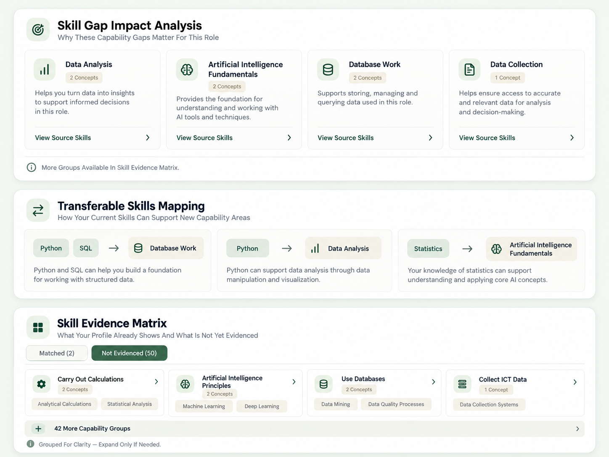

# Feature 3 — Career Details UI & Content Refinement (Codex Handoff)

**Scope:** Refine the **existing** Career Details page only. This is a follow-up to the already implemented three-panel analysis, **not a rebuild**. Use the attached reference image as the visual target.

Place **this Markdown and `Feature3_Career_Details_UI_Reference.png` together in `docs/`**. Match the image's **layout, icons, density, mini-card proportions and hierarchy** closely using actual responsive React components; **do not** place the image itself inside the UI. Retain the application's existing green/neutral palette and typography. Reference skill labels, counts, bridges and descriptions are **illustrative only**—never hardcode them as factual data.

## 1. Non-negotiable boundaries

- **Preserve:** full-width Career Overview; verified ESCO description/source; circular Profile Relevance score; Explore Pathway; existing search, ranking, pagination and 30% qualification; ESCO index/skill matching/formula; API compatibility; Feature 4; SDG code.
- Reuse `POST /api/v2/roles/analysis`: deterministic call (`generate_ai:false`) first, optional Runpod call (`generate_ai:true`) later. Preserve in-flight deduplication, cache, stale-profile/role protection and existing model validation. **No new endpoint, model, vendor, credentials or additional LLM calls** for this UI refinement.
- **Facts:** Python + ESCO own skill IDs, evidence status, essential/optional relationships, counts and source URLs. **Runpod** only supplies validated conditional analysis for A and inferred bridges for B. C never depends on Runpod. No invented proficiency, impacts, task claims, courses, career readiness, links or skill bridges.
- Without Runpod credentials, the page must remain **clear, useful and honest**. Do **not** fabricate AI content to match the visual reference. No live Runpod/Tavily requests during implementation.

## 2. Approved page structure

Keep Career Overview unchanged. Under it, display **three full-width outer cards stacked vertically**, each containing **compact mini-cards** (not three outer cards side by side):

| Card | User question | Subtitle (concise) | Inner layout on desktop |
|---|---|---|---|
| **A. Skill Gap Impact Analysis** | Why does this capability area matter for the role? | `Why These Capability Gaps Matter for This Role` | Up to **4 mini-cards** in a responsive grid |
| **B. Transferable Skills Mapping** | How can existing skills support new capabilities? | `How Your Current Skills Can Support New Capabilities` | Up to **3 visual bridge mini-cards** |
| **C. Skill Evidence Matrix** | What's evidenced, and what's not? | `What Your Profile Shows—and What Is Not Yet Evidenced` | **4 capability tiles** initially, with gradual expansion |

Use clear heading icons in muted rounded icon tiles (target, arrows/link, grid), relevant group icons (chart/brain/database/cloud/collection, generic fallback), visible chevrons, short skill chips, subtle borders and whitespace. Use existing icon assets/components; don't add a UI library. Desktop grid 4 columns for A/C only if room allows, tablet 2, mobile 1. B up to 3 desktop columns, responsive stacking. No overflow or tiny text.

**Copy rule:** one brief line of helpful content per item (ideally ≤20–25 words). Remove the repeated technical sentences like `2 distinct occupation requirements are not evidenced by this profile; competence has not been assessed.` Put the necessary definition of **Not Evidenced**, score limitations, grouping/order methodology and evidence details in **one small `About This Analysis` disclosure/tooltip**, not every row.

## 3. A — Skill Gap Impact Analysis

Replace the existing long divider-separated groups with **up to four capability mini-cards** initially. Each:

1. Semantic icon + clear, properly capitalised, source-consistent capability title.
2. Small **`N Concepts`** badge using exact unique ESCO concept count.
3. **One concise explanation** of the capability's relevance **only when supported by evidence**.
4. Bottom **`View Source Skills`** expander + chevron: original ESCO names, canonical URIs, relationship types, legitimate citation links.

**Description precedence:** existing **validated Runpod** text if present → concise wording genuinely supported by supplied ESCO definitions → when neither exists, representative official skill names or neutral `Explore the related ESCO requirements`. No generic made-up work benefits or pretend AI summaries. Display a **single subtle AI-unavailable indicator** when appropriate; not one warning for every group. If there are more groups, show `Explore More in Skill Evidence Matrix`. Do not call group order an **importance/impact ranking**, and don't create High/Medium/Low meters.

## 4. B — Transferable Skills Mapping

Replace the plain list/empty strip with up to **three bridge mini-cards** matching the visual reference:

`[Recognised matched skill chips]  →  [Actual unevidenced target capability]`

Below each bridge: **one short, conditional, evidence-grounded sentence** from the **existing validated Runpod** output. All source and target IDs must exist in that user's actual profile/role evidence. Label as **potential learning connection**, not official ESCO equivalence or proof of ability. Preserve legitimate evidence links where available.

**Runpod absent/invalid:** display a compact, icon-led, well-spaced neutral state: **`AI Skill Connections Aren't Available Yet`** and `Your verified skill evidence is still available below.` Never imply the user has **no transferable skills**. If no matched skills or no gaps exist, use a specific factual empty state instead. **Do not create dummy skill bridges or extra LLM calls.**

## 5. C — Skill Evidence Matrix

- Exactly two accessible tabs: **`Matched (N)`** and **`Not Evidenced (N)`**; default **Not Evidenced**. Tab numbers count distinct **underlying concepts**, not groups. Keep existing correct backend totals.
- In each tab show **four compact capability tiles initially** (icon, Title Case group heading, `N Concepts`, **maximum two representative sourced skill chips**, chevron). `View Source Skills` expands exact ESCO concepts, essential/optional types and original source links.
- **Never auto-list all 50 unevidenced concepts or 47 groups.** Below first four tiles add one controlled **`Explore X More Capability Groups`** action. Reveal **4–8 groups per click**, not all at once; keep rendering bounded. Large individual groups also reveal detailed skills on demand. Original complete data remains inspectable eventually; don't drop concepts.
- Matched tab uses genuine recognised skill concepts or sourced groups, not competence ratings. Maintain clear distinction between matched and not-evidenced status.

### Improve display grouping *only when verifiable*

Currently ~50 concepts can produce ~47 tiny groups. Reuse the existing `profile_relevance.development_areas` **full-output** and verified ESCO `broader` links. If the index supports a coherent higher parent (including a second hierarchy hop when justified), create a **minimal additive presentation-only roll-up** to consolidate groups. Preserve every original concept/URI, essential/optional type and unique count; count each concept once per tab. **Never invent an ESCO taxonomy or merge unrelated skills.** If no trustworthy parent exists, leave the sourced group individual.

**Compatibility:** keep original canonical group IDs, AI references, API contracts and cache semantics unchanged. If introducing display-only roll-up IDs, map explicitly back to original groups instead of overwriting them. Do not alter matching or Feature 4. Favor safe UI condensation over an expensive grouping rewrite.

## 6. Correct capitalization & terminology

Create/reuse **one UI-only display formatter** and apply it consistently across the three cards (including buttons and skill chips):
- `carry out calculations` → **Carry Out Calculations**
- `principles of artificial intelligence` → **Principles of Artificial Intelligence**
- `collect ICT data` → **Collect ICT Data**
- Preserve **AI, SQL, ICT, ETL, API, Python, Power BI** and similar true brand/acronym casing. Avoid blindly transforming proper names.
- You may show shorter **source-consistent display labels** when verified (e.g. `AI Fundamentals`), but original official ESCO names must be available in source details; **do not** invent or hardcode a giant alias catalogue.
- **UI titles and concept labels:** consistent Title Case. **Sentences:** natural sentence case. No microscopic dense text.

## 7. Implementation scope and progressive UI

**Inspect only these known paths initially:**
- `src/frontend/components/CareerAnalysisPanels.tsx`
- `src/frontend/components/CareerDetails.tsx`
- `src/frontend/lib/career-analysis.ts`
- Their scoped Career/Future-Role CSS and directly related frontend tests.

**Only if required for safe display roll-up:** inspect/edit `src/services/future_roles/career_analysis.py`, `src/profile_relevance.py` and existing additive models/tests. Avoid unrelated backend files, Runpod transport/prompts, Tavily, credentials or Feature 4.

Render deterministic groups and C **immediately**; only optional A/B AI interpretation loads progressively. Keep citations, selected-role state, keyboard navigation, accurate counts, content expansion and fallback. Never put fixed picture-example data in production components.

## 8. Targeted acceptance tests

1. **Visual**: three stacked full-width outer cards; A up to 4 mini-cards, B up to 3 bridge cards, C 4 visible tiles; icons, spacing and responsive desktop/mobile wrap closely follow the reference.
2. **Content**: short purpose subtitles and one-line content; no repeated generic requirements paragraphs; correct capitalization/acronyms; AI-offline A truthful and B polished empty state.
3. **Data**: only Matched/Not Evidenced tabs; default Not Evidenced; accurate concept counts, distinct concept coverage, stable URI/source disclosure; remaining groups revealed **incrementally** with no mass list.
4. **Safety**: no fabricated groups/bridges/effects and no changed AI validation; optional AI output only from original validated pipeline.
5. **Regression**: overview, score, role selection, search/sorting and Explore Pathway behave unchanged; Feature 4 untouched.

Run relevant **focused** frontend rendering/browser tests and TypeScript checks; run backend grouping tests **only if** grouping backend changes. Use mocked/no-key AI by default. Explicitly separate mocked test results from untested live inference.

## 9. Codex token-efficiency rules (strict)

- Implement directly; **no planning document, broad repository audit, web research or old handoff rereads**.
- Use narrow `rg` searches and scoped file reads; **never dump full ESCO JSON/CSV, unrelated project modules or giant logs**.
- Prefer **frontend-only** edits and reuse existing components, icons, APIs, CSS and grouping. No new dependencies or speculative functionality.
- Run **focused tests once**, repeat only failed ones after fixes. Do not create repeated screenshot batches.
- **Final reply ≤180 words:** files changed, what A/B/C look like now, test results, whether backend grouping changed, and explicit note that no live AI calls were made.

**Proceed with implementation. Mirror the reference image's presentation—not its illustrative content—and retain all existing factual guarantees.**
