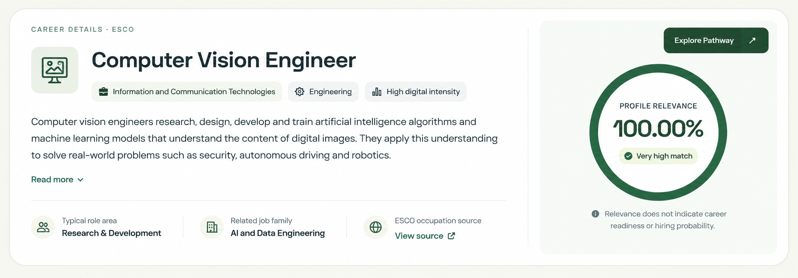

# Feature 3 — Career Overview Card Visual Redesign (Codex Handoff)

**Objective:** Restyle **only the first / top Career Overview card** on the existing Future-Role Matching **Career Details** page to closely match the attached visual reference. All displayed occupation facts, score values, labels and metrics must come from **the currently selected role, current recognised profile and existing verified ESCO/API data**. The screenshot is a **layout reference, never a data source**.



Place this Markdown file and `Feature3_Career_Overview_Design_Reference.png` together under `docs/` before running Codex. **The implementation must be responsive React/CSS, not an embedded screenshot.**

## 1. Exact approved change

- Preserve the current single **full-width, rounded Career Overview container**, but improve its visual hierarchy with a **two-column composition** like the reference:
  - **Left (roughly 65–70%):** small `Career Details · ESCO` eyebrow, subtle icon tile, large occupation title, optional verified metadata chips, concise ESCO description with existing Read More / Show Less, and a compact factual information row.
  - **Right (roughly 30–35%):** softly tinted background subpanel with the existing **circular Profile Relevance gauge**, score label and the existing brief non-readiness disclaimer. A subtle divider separates the columns.
- **Move the existing `Explore Pathway` action from the top-right to the bottom centre of the entire outer card**, *below both columns*. It must read **`Explore Pathway ↗`** (or existing appropriate arrow icon) and be styled as a **plain, prominent text link**, **NOT** a filled/outlined/pill button. Use a thin top separator or clear spacing, centred horizontally. Keep a visible hover underline and keyboard focus indicator. It must navigate to the **same existing pathway route with the exact selected canonical role and current profile**.
- Maintain the existing application's **green/neutral palette, typography, subtle borders, rounded shapes, spacing and icons**. Treat the generated mockup's sizing, icon treatment, description arrangement and gentle right-panel tint as design inspiration. Avoid overly tall empty areas, duplicated text or fake badges.

### Composition schematic

```text
+-----------------------------------------------------------------------+
| CAREER DETAILS · ESCO                                                  |
|                                                                       |
| [role icon]  Selected Occupation           |  [soft tinted score panel]|
|              [optional verified chips]     |     PROFILE RELEVANCE    |
|                                            |       (radial gauge)      |
| Official ESCO description (clamped)        |         47.00%*          |
| Read More / Show Less                      |   not career readiness   |
|                                            |                          |
| [dynamic factual item] [optional item] [official ESCO source link]     |
|-----------------------------------------------------------------------|
|                        Explore Pathway ↗                               |
+-----------------------------------------------------------------------+
*47.00% is illustrative only; always display actual backend-calculated value.
```

## 2. Critical: **dynamic and authentic data only**

The reference image contains **illustrative content that must never be hardcoded or inferred as fact**. In particular **do not copy** its `Computer Vision Engineer` sample, `Information and Communication Technologies`, `Engineering`, `High digital intensity`, `Research & Development`, `AI and Data Engineering`, or `Very high match` claims unless the selected occupation's **actual existing sourced metadata explicitly supports that specific fact**.

**Required binding and source rules:**

1. **Occupation title:** Use the current selected occupation's verified ESCO title and canonical ID. UI-only title casing is allowed; never mutate the source value or ID. The icon may be generic, or derived from an existing grounded role category, but **must not imply an unsupported category**.
2. **Description:** Use the actual selected occupation's existing ESCO description; preserve the working **single-element Read More / Show Less** behavior. No duplicated preview/full copy; no LLM-written role descriptions.
3. **Profile Relevance:** Use the **existing backend-calculated value unchanged** (including below-threshold search matches). Use that same value for the SVG/CSS radial progress and the textual percentage. **Never compute a new relevance score in React**. The percentage represents alignment of recognised profile skills with the occupation, **not** essential-requirement coverage, competency, eligibility, career readiness or hiring probability. For no recognised profile / undefined score, show an honest **Unavailable** state instead of `0%` or `100%`. Handle legitimate `0%` and `100%` correctly.
4. **Optional metadata chips:** Only render chips backed by fields already present in the verified occupation response (e.g. existing classification/group fields, *if they genuinely exist*). If no trustworthy fields exist, **omit the chips altogether**; do not create generic career-family, industry, seniority, digital-intensity or labour-demand labels to fill visual space. Do not call Runpod or Tavily to invent these.
5. **Bottom information row:** Prefer **up to three factual, dynamically bound mini-items**, using available existing evidence, for example: a correctly defined `Recognised Requirements` or `Recognised Skills` count, a correctly defined `Areas to Explore` count, and an **official ESCO occupation source** link. Show counts **only if they are already available/derivable reliably from existing API evidence**, with labels that match precisely what is being counted. Avoid mixing distinct concepts with groups or implying readiness. When a metric is unavailable, **omit that mini-item and let the others reflow**; the row must still look intentional with just the source link.
6. **Official source:** Keep the existing verified ESCO occupation source URI, link behavior and safe URL validation. Only show official/source-validated links; avoid duplicating source links elsewhere in the same card.
7. **No fake content:** Absolutely no sample numbers, invented role attributes, placeholder occupation text, fabricated job-family labels, unsourced statistics or fixed skill examples in production JSX. Test fixture data is permitted **only in tests**.

**Data availability rule:** A well-balanced two-column design matters more than filling every chip/metadata slot in the mockup. Fewer truthful fields are better than a polished but fictional card.

## 3. Relevance gauge and link interaction

- Reuse the **current radial Profile Relevance indicator** and score formatter. Place it centrally in the tinted right panel, with sufficient breathing room.
- Keep the exact actual displayed score precision already used by the app; don't introduce new `Very high match` / `Good match` badges or arbitrary performance categories.
- Keep the existing concise caveat nearby: `Relevance does not indicate career readiness or hiring probability.` It can use an info icon and muted text, not a large paragraph.
- Remove the former **top-right Explore Pathway button**, ensuring exactly **one** `Explore Pathway` link remains on the card, at the **bottom centre**. Preserve route, role selection, profile context, accessible name and keyboard activation.
- **Do not** recreate the removed `About This Score / Sources & Limitations` bottom section from prior design work.

## 4. Responsive layout / polish

- **Desktop:** generous but not oversized left content area; compact visually coherent tinted score panel at right; bottom-centred pathway text link spans the whole card. Consistent vertical rhythm, icon alignment, subtle internal dividers.
- **Tablet:** columns may narrow without overlapping. Use `min-width: 0`, flexible gaps and safe text wrapping.
- **Mobile:** stack occupation content, then gauge; pathway link centred underneath both. Avoid clipped headings/descriptions, horizontal scroll and excessive blank padding. CTA remains a clear clickable link with accessible tap target even though it has no visible button container.
- Preserve current design tokens/CSS conventions. Reuse existing icon system; **no new UI framework/chart dependencies**, no fixed screenshot background.
- Maintain readable contrast and accessible gauge text for screen readers.

## 5. Preserve all other working functionality

- **Only modify the top Career Overview presentation and pathway action position.** Leave the three lower sections — **Skill Gap Impact Analysis**, **Transferable Skills Mapping**, **Skill Evidence Matrix** — as currently implemented.
- Do **not** change ESCO v1.2.1 index, skill alias resolution, full catalogue matching, IDF scoring/qualification, search override, relevance sorting, pagination, Runpod analysis, Tavily resource discovery, Feature 4 reskilling engine, SDG features, backend routes, profile integration or `.env` credentials.
- Direct navigation/refresh, role changes, unrecognised/empty profile, source link, score accuracy and pathway navigation must still work.

## 6. Minimal implementation process and acceptance tests

1. Start by inspecting **only** `src/frontend/components/CareerDetails.tsx`, its related Career/Future-Role CSS, and any directly used occupation/gauge/navigation components or frontend tests. File names may vary after merges; locate narrowly with `rg` if required.
2. Reuse existing API fields and route handlers. No new FastAPI endpoint unless a critical already-proven frontend binding cannot be expressed otherwise; report rather than invent a new schema.
3. Build the left/right layout and dynamic data slots. Remove unsupported mock-inspired chips/role-family claims entirely when corresponding data isn't available. Relocate the CTA.
4. Focused checks:
   - Different selected occupations show **different real titles/descriptions/source links**; no `Computer Vision Engineer` hardcoding.
   - Distinct profiles produce the **existing correct score**; 0%, intermediate, 100%, and unscorable states render correctly.
   - Existing Read More / Show Less expands **one** description element without duplication.
   - Dynamic mini-items have accurate meaning; absent source fields cause omission, never fake values.
   - Exactly one **bottom-centred plain text** `Explore Pathway` link works for the selected role; no top-right button.
   - Desktop/mobile rendering, wrapping, accessibility and lower cards unaffected.
5. Run **focused frontend rendering tests and TypeScript checking**. If available, do one focused browser visual check for desktop and mobile. Use existing fixtures, **no live Runpod/Tavily API calls**. State clearly which checks were actually executed.

## 7. Codex token- and resource-efficiency (strict)

- **Implement immediately.** No new plan/document, repo-wide audit, web research, refactoring spree or previous handoff reread.
- Read **only narrowly relevant frontend files**; prefer targeted `rg` and snippets; never dump the ESCO dataset or unrelated logs.
- **Frontend-only minimal targeted changes** wherever possible; reuse the current gauge, source link, icons and pathway routing. No extra dependencies.
- Run targeted tests once; rerun only failures after fixes. Avoid unnecessary screenshot batches.
- **Keep final Codex report under 150 words:** changed files, dynamic bindings and omissions, CTA placement, tests passed/failed and any real-data fields unavailable.

**Success criterion:** The existing Career Overview is visually close to the supplied screenshot, but entirely driven by **real selected-role and profile data**, with an accessible **`Explore Pathway ↗` text link centred below the content**, and no changes to the actual matching or pathway functionality.
