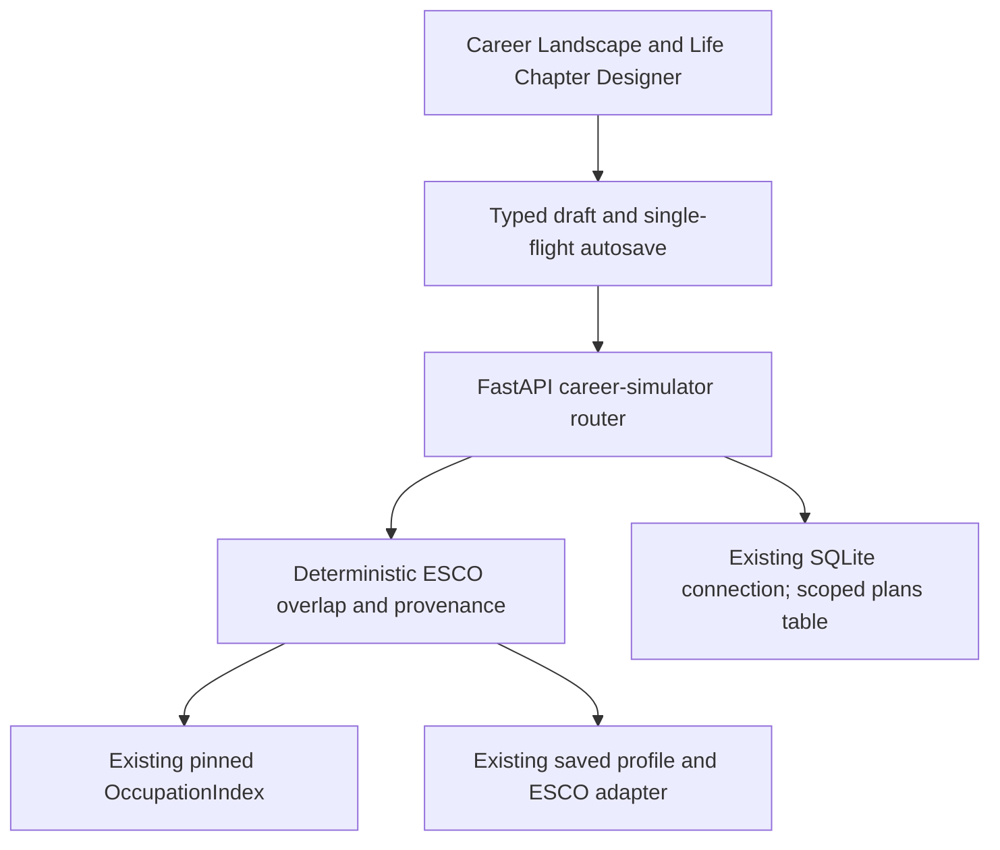

# AI Career Transition Simulator

Route: `/career-simulator`, final employee navigation item. Start normally with
`npm run dev` from `src/frontend`; no new dependencies or provider keys required.
The shared PathwaayRibbon remains unchanged apart from the new final link.

## Reference source audit

Both complete supplied TSX sources were read and copied unchanged to
`docs/reference/`; see `career-simulator-audit.md` for the phased audit/log.
CareerLandscape's rounded trajectory cards, sequential role cards, arrows and
source detail composition were rebuilt as working selections. Designer's
horizontal circular nodes, selected detail, previous/next navigation, goal
category selection and add/edit/remove modal patterns were adapted. The original
static tracks, fake statistics, assumed role years, financial/readiness/impact
calculators and destructive reset were discarded. No Tailwind, lucide,
framer-motion, stock images or original global stylesheet was added. Existing
dark-green Pathwaay presentation and native dialog/CSS replace those dependencies.
This is a functional adaptation, not a pixel-identical reproduction.

## Architecture and endpoints



All endpoints use `/api/v2/career-simulator`:

| Endpoint | Purpose |
| --- | --- |
| GET `/config` | Effective server cap, coverage/version and demo security mode |
| POST `/roles/search` | Bounded real occupation search, independent of matching thresholds |
| POST `/candidates` | Shared-essential-skill branches, excluding selected nodes |
| POST `/roles/detail` | Verified role/requirements, original-profile gaps and citations |
| GET `/plan?profile_id=…` | Read the capability-scoped journey |
| PUT `/plan` | Validated revisioned upsert |
| DELETE `/plan?profile_id=…&revision=…` | Confirmed reset of this journey only |

All except config require `X-Career-Simulator-Key`. No endpoint invokes model
generation, resource discovery, Tavily or Runpod. Links to existing Career
Details/Pathway are explicit user navigation; those existing pages keep their
own provider behavior. Incoming `role_id` query context is validated and offered
as a destination, never a current-occupation assertion.

## Data provenance and selection

Installed ESCO: v1.2.1, full pinned index, 3,658 occupations and 14,579 skills.
The existing loader validates manifest/checksum/catalogue. The simulator requires
full, nonsynthetic coverage for exploration/writes and validates released roles,
complete requirements, native occupation provenance and relationship support.
Limited fallback disables exploration; existing saved user content remains readable.

Method `esco-essential-skill-overlap-v1`: count the intersection of source and
destination essential canonical skill IDs. Sort by descending count, then title
and URI; title sort is also implemented. Reverse-index unions bound candidate
discovery; six candidates are paginated. Search permits zero-overlap real
occupations labelled user-selected aspirations. No 30% qualification rule is
applied and the existing matching formula is untouched.

Missing essentials are computed against the original saved recognised skill IDs
via `adapt_workspace_profile`, never against skills hypothetically acquired from
selected occupations. Self-reported profile skills are not assessed proficiency.
No profile free-text occupation is automatically treated as a canonical ID.

Actual local-index compatibility records include:

- [data scientist](http://data.europa.eu/esco/occupation/258e46f9-0075-4a2e-adae-1ff0477e0f30)
- [statistician](http://data.europa.eu/esco/occupation/ac8b3cd1-a127-4e6a-8208-5cfcf7111955)

These records share 37 essential canonical skill IDs in the installed release.
That count is an application calculation, not an ESCO career-transition edge.
Role descriptions, requirements, source IDs/URLs and release are resolved from
the registry; no AI labour-demand, salary, seniority or outcome claims are added.

## Landscape and timeline behavior

The user explicitly chooses a start, then one or more destination roles.
`CAREER_SIMULATOR_MAX_DESTINATION_STEPS` is server-owned (default three, bounded
one to eight); the effective value is returned to the client. Repeated roles are
rejected. Saved paths beyond a lowered cap remain intact with a review warning.
Changing/replacing/backtracking a path preserves personal entries; removal is
confirmed. An accepted start-plus-destination unlocks the lower section.

The horizontal timeline includes chosen career stages, sourced skill intentions,
personal goals and breaks. User dates, relative years, duration and notes are
optional. No goal or calendar date is preselected. Dated/relative/undated entries
are deterministic, career path order is preserved, and undated personal entries
have explicit Move earlier/later controls. Navigation counts mean viewing a
milestone, not completing a career. Edit a career node's timing/notes in the
Designer; edit its occupation via Landscape.

Skills come from destination requirements, retain canonical IDs and originating
role/source references, and are not proficiency claims. Removed-role skills are
kept as needs-review entries; users can reassign via the documented selector,
delete explicitly, or retain as a personal goal. Goals and breaks are never
deleted on path changes. Evidence changes produce a review banner; writes require
explicit acknowledgment. Source IDs are recalculated server-side, not trusted
from browser edits. Strict edit payloads omit server `origin`/review/source data.

Course milestones are optional in the handoff and are not implemented. Use the
existing explicit Reskilling Pathway link instead; no unrequested paid discovery.

## Storage, security and autosave

Additive table `career_simulator_plans` uses the existing SQLite file/connection:
opaque plan ID, SHA-256 capability owner scope, existing profile ID, revision,
validated JSON references/user entries, and server timestamps. Unique
`(owner_scope, profile_id)` enforces one journey within the approved demo scope.
Create/update/delete use `BEGIN IMMEDIATE`; stale revisions get HTTP 409. Saves
and deletes also bind to the opaque `plan_id`, preventing stale writes after a
journey is reset and recreated with a new identity.
Initialization does not clear any table or replace profiles/evidence.

The browser generates 256 random bits once and retains the capability in local
storage. Only its hash is stored server-side. A bare profile ID cannot access
plans. Different capabilities cannot retrieve or overwrite another scope's plan.
This is **local-demo capability security**, not verified account ownership.
Existing profile endpoints remain unauthenticated; no claim is made to secure
those or to establish who owns a profile. Lost browser storage has no recovery
service; shared devices/XSS can expose browser capabilities. Production use
needs real authentication, account authorization and recovery. Never publish
capabilities or user goal text in logs.

650ms debounced saves run one at a time. New edits during a save remain queued;
responses do not replace a newer draft. Saved is shown only after acknowledgment.
Errors/conflicts stop automatic saving while retaining the draft. Explicit retry
uses the current revision and cannot override another tab. Reload/review first
downloads the retained draft after confirmation; reset requires confirmation.
Page/route navigation warns about unsaved data. This is not an offline browser
database: closing/discarding an unsaved tab can lose those edits. Saved content
survives normal reloads/revisits. Profile changes stop saving the old draft.

## Verification and commands

Python uses the repository's unittest convention rather than adding pytest:

```powershell
$env:PYTHONPATH = 'tests;.'
.venv/Scripts/python.exe -m unittest discover -s tests -p test_career_simulator.py
npm.cmd --prefix src/frontend run typecheck
npm.cmd --prefix src/frontend run build
npm.cmd --prefix src/frontend run test:components
npm.cmd --prefix src/frontend run test:logic
```

Run provider regression suites with mock/disabled keys and blocked network,
as done in this session; never use real credentials for automated tests.
From `src/frontend`, new pure/component checks:
`npx tsx --tsconfig tsconfig.json --test ../../tests/frontend_career_simulator.test.ts`.
Focused browser configuration creates an isolated temporary SQLite database and
uses the existing labelled sample profile as test data with real installed ESCO
roles. No production user/profile or local database is changed.

```powershell
$env:PW_BROWSER_CHANNEL = 'chrome' # optional installed Chrome fallback
npx playwright test --config playwright.simulator.config.ts
```

For production-build verification, build with `NEXT_DIST_DIR=.next-merge-check`
and `BACKEND_URL=http://127.0.0.1:8127`, then set
`SIMULATOR_PRODUCTION_TEST=1` before that browser command.

The previous historical `test_discovery_integration` byte-freeze failure was
already confirmed against committed HEAD in the prior task; it is not altered
to hide unrelated baseline drift. Actual final counts/browser outcomes are
recorded in the audit phase log. No live provider requests, commits or pushes.

## Final verification and file inventory

Final results: 13 simulator + 86 focused existing backend checks passed across
the executed unittest runs. Eight new frontend tests, 30 existing component
tests and six logic tests passed. Standalone TypeScript and the final Next.js
production build passed. One production-backed Playwright flow passed using
installed Chrome, real pinned ESCO and isolated existing demo-profile test data.
It checked save/reload, path preservation, a stale revision and retained UI draft,
and mobile overflow. Native keyboard controls/dialog semantics are implemented;
an exhaustive assistive-technology/keyboard matrix was not run. No live providers.

Only existing application integrations changed are `src/main.py` (two router
lines) and `src/frontend/app/PathwaayRibbon.tsx` (one final navigation item).
All earlier uncommitted Career Details, pathway, retry and theme changes remain.

New files:

- `src/models/career_simulator.py`: bounded strict plan/search/timing inputs.
- `src/services/career_simulator.py`: evidence engine, reconciliation, capability
  scoping and transactional persistence in the existing database.
- `src/api/career_simulator.py`: new scoped endpoints.
- `src/frontend/app/(workspace)/career-simulator/page.tsx` and `simulator.css`:
  isolated route and dark Pathwaay styling.
- `src/frontend/components/CareerSimulator.tsx`, `CareerLandscape.tsx` and
  `LifeChapterDesigner.tsx`: composition, exploration, horizontal editor/dialogs.
- `src/frontend/lib/career-simulator.ts` and `use-career-simulator.ts`: typed
  transport, explicit edit payloads, state, autosave and conflict recovery.
- `tests/test_career_simulator.py` and `tests/frontend_career_simulator.test.ts`:
  backend persistence/evidence/security and frontend component/helper coverage.
- `src/frontend/e2e/career-simulator.spec.ts` and
  `src/frontend/playwright.simulator.config.ts`: isolated real-index browser flow.
- `docs/career-simulator-audit.md`, this document, the exact supplied handoff and
  the two unchanged TSX references: audit, phased results and source provenance.

Remaining limitations: demo capability ownership/recovery, no durable unsaved
offline buffer, optional learning-resource milestones omitted, no predictive
career-transition evidence. Authentication/recovery requires a separate approved
project before production deployment. A source/index outage intentionally disables
new exploration; it does not erase saved user data. No decision is needed to use
the delivered local demo. Nothing staged, committed or pushed; branch remains KW.

## Screenshot-led UI refinement

The Landscape now presents a horizontally pannable branching card canvas with
curved SVG connections and a highlighted selected route. Previously retrieved
siblings remain visible in their branch columns; no speculative future roles or
extra discovery requests are generated for the diagram. Existing selection,
replacement, search, cap and save callbacks remain in use. Compact card details
retain descriptions, ESCO evidence and Career Details/Pathway links.

The Designer uses a starting-point toolbar, viewing badge, edit/remove icons,
Add Life Chapter action, edge navigation arrows and a connected circular-icon
timeline. The selected chapter is shown in a separate context card below.
The native chapter dialog now has Goals/Breaks/Documented Skills tabs, icon-based
checkbox tiles, grouped timing inputs and a fixed action footer. Existing goal
choices and blank optional dates/duration are retained. No reference example
percentages, role forecasts or assumed dates were introduced. Pathwaay colours,
backend contracts, algorithms and persistence logic are unchanged.

Verification after the UI refinement: nine focused frontend tests passed;
TypeScript checking and the production frontend build passed. One isolated
real-ESCO Playwright scenario passed, covering branch selection, chapter tabs,
add/editable timeline entries, SQLite save/reload, retained entries after path
changes, revision-conflict handling and mobile overflow. Desktop graph, timeline,
chapter-modal and mobile screenshots were captured in the ignored frontend
test-results directory and visually reviewed. No live provider calls were made.

## Click-to-toggle landscape and zoom

Occupation cards now toggle the chosen step directly. Deselecting an earlier
step removes that step and later career choices while preserving personal
entries through the existing changePath handler. Cards use
aria-pressed and keyboard activation; only selected cards are highlighted.
The back-step, replacement, pagination and sort controls have been removed.
Discovery retains its existing default essential-skill-overlap ordering and
first-page limit; use occupation search for other catalogue entries. The restart
action is an accessible icon. Explicit path acceptance still unlocks the Designer.

The landscape panel is wider and branch cards have larger horizontal/vertical
gaps. Its canvas has no scrollbars: pinch gestures (Ctrl-wheel trackpad events),
zoom buttons, Fit view and background dragging control the view. Two-pointer
touch pinch and keyboard zoom/pan are supported without dependencies or API
changes. Zoom is local presentation state; SQLite and ESCO logic are unchanged.

Verification for the click-to-toggle refinement: eleven focused frontend tests,
explicit TypeScript checking and the production build passed. The isolated
real-ESCO browser scenario passed after the pan check was corrected, covering
initial unselected cards, selected-state toggling, button zoom, a synthetic
trackpad-style Ctrl-wheel pinch event, keyboard zoom/fit, background mouse
dragging, hidden canvas overflow, save/reload, retained chapters and mobile
layout. A desktop landscape screenshot was visually reviewed. Physical trackpad
hardware and two-finger touch input were not exercised by this automated test.
No backend code, provider calls, commits or pushes were part of this refinement.

## Landscape readability cleanup

Column gaps are now wider and the desktop canvas is taller, allowing Fit view
to use a larger scale. Card titles/metadata have larger type. Existing occupation
title formatting is reused throughout simulator occupation labels, without
changing canonical ESCO data or user-authored goal titles. Selected cards carry
a coloured Your Selected Path tag. Only connections with selected endpoints
are drawn. Landscape Role Details expanders have been removed.

The normal save-status toolbar, Reset journey, Reload/review action and demo
notice are removed from the visible interface. Autosave and its accessible live
status remain; blocking save errors and retry remain visible. The restart icon
still clears the chosen career path while retaining personal chapters. The local
intro/header/control spacing is more compact; shared navigation is unchanged.

Verification: twelve focused frontend tests, TypeScript and the production
build passed. The isolated real-ESCO browser test passed, including title-case
selection, selected-only connection counts, coloured tags, absence of removed
controls, zoom/pan, persistence and reload, conflict handling and mobile layout.
The landscape screenshot was visually reviewed. The pan test now chooses
visible background to avoid the shared fixed navigation. Returning to an
identical saved draft is verified against the stored plan, since the existing
autosave live-status label can remain Unsaved changes without another save
transition. That status-only limitation was left unchanged; it is no longer
visible in the normal interface. No backend or autosave logic was modified.

## Stable card positions and selection elevation

Choosing an occupation now updates its state in the original discovery row,
without moving it to the top. Selected occupations restored without a cached
discovery page are retained as fallback cards. Connections continue to follow
the measured card positions with curved paths. Unselected cards use softer
text, quieter borders and subtle shadows; hover/focus retain clear affordances.
Selected cards use an elevated shadow, slight lift and highlighted border.

The path-change confirmation has been removed: deselection and restart update
the route immediately through changePath, preserving personal milestones.
Other unrelated confirmation dialogs and all backend calculations are unchanged.

Verification: thirteen focused frontend tests, TypeScript and the production
build passed. The isolated browser flow passed with a non-first destination
selected in place, matching pre/post selection card order, selected-only curved
connections, no path-change dialog, and existing persistence/conflict/mobile
checks. The updated landscape screenshot was visually reviewed. No live
provider calls, backend changes, staging, commits or pushes were performed.

## Life Chapter Designer stepper

The Designer now matches the Landscape panel width. Its toolbar retains edit,
remove and Add Life Chapter, without Starting point, viewing count or the
standalone documented-skill action. Documented Skills remain available in the
chapter dialog. Personal chapter deletion is immediate, without confirmation;
career path nodes are still managed by the Landscape.

ChapterStepper is a separate presentation component using the real timeline
items rather than fabricated stages. Five actual chapters produce five evenly
spaced nodes. Type badges replace unspecified timing labels; redundant default
subtitles are removed, while real user notes can appear underneath. Dates remain
available in chapter details/editing. Node clicks and edge arrows update the
selected position, colour prior/current nodes and glow the active ring. A bright
progress line fills exactly between the first node centre and selected centre
with a four-tenths-second transition. Hover/focus lift is interactive; reduced
motion disables transitions. Selection progress is not assessed proficiency or
career completion. ESCO, API, SQLite and planning calculations are unchanged.

Verification: fourteen focused frontend tests, TypeScript and the production
build passed. The isolated browser scenario passed with five real timeline
items, fourth-node progress at seventy-five percent ending within two pixels of
its centre, the four-tenths-second CSS transition, hover lift, arrow navigation,
immediate deletion without a dialog, persistence/reload and mobile checks.
Reduced-motion operation was also exercised and the updated screenshot reviewed.
No live providers, backend modifications, staging, commits or pushes occurred.

## Chapter interaction cleanup

Timeline hover retains its lift without a rectangular background or square
shadow. Keyboard focus is highlighted on the circular badge. Job Title badges
are now Job, and the Documented Skills tab is Skills. The add dialog now offers
Goals and Skills only; the separate Breaks tab and Career break goal preset are
removed. Existing saved break chapters and their editing remain supported.
Goal option hover/focus uses an animated highlighted outline with a solid dark
fill, and selected options retain the emphasis. Lower edit/remove/move buttons
are removed, with toolbar edit/delete icons retained. Backend contracts, stored
chapters and timeline ordering rules remain unchanged.

Verification: fourteen focused tests, TypeScript and production build passed.
The isolated browser scenario passed with only Goals/Skills tabs, option hover
fill and checked styling, a shadow-free transparent node hover with retained
lift, immediate deletion, animated progress, persistence and mobile checks.
Updated screenshots were captured and reviewed. No live providers, backend
changes, staging, commits or pushes were performed.

## Position-based chapter insertion

Selectable dots between chapters (and after the last chapter) choose an
insertion point. Add Life Chapter appears only for a selected dot; choosing a
node or navigating with arrows exits insertion mode. New Goals and Skills are
placed at the dot, and date/relative-year inputs are removed for these kinds.
Duration remains optional. Previously stored dates remain metadata but no longer
control timeline placement. Type tags are beneath the node titles.

Milestone JSON gains an optional after_id anchor (role:<ESCO occupation ID> or
a milestone ID), persisted by the existing SQLite JSON payload. No database
migration or duplicate storage is needed. Older payloads without anchors remain
readable. New placements use ordered anchored traversal, retaining career-route
order; multi-add chapters remain consecutive. Deletion reattaches descendants
to the prior visible node. Missing anchors from changed paths fall back to the
end without deleting personal entries; cyclic/self anchors are rejected by
PlanWrite validation. Matching, evidence recognition and external providers are
unchanged.

Verification: sixteen focused frontend and fifteen backend tests passed,
including anchored multi-insertion, deletion reattachment, JSON round trips,
legacy payload compatibility and cyclic-anchor rejection. TypeScript and the
production build passed. The isolated browser scenario passed after correcting
dot stacking so adjacent node hit targets cannot block dot clicks. It verified
Add gating, skill insertion between jobs, saved/reloaded position, removed date
inputs, below-title tags, progress animation, deletion and mobile behaviour.
Screenshots were reviewed. No live provider calls, staging, commits or pushes.

## Skill picker and waypoint progress

Skills use a custom searchable combobox/listbox instead of a browser select.
Only canonical skill names are displayed; requirement kind and occupation names
are omitted from option labels. ESCO IDs and source occupation associations are
retained in the selected value and unchanged validation. Duplicate canonical
skills across route occupations share one displayed choice, retaining the
current selection when editing. Arrow/Home/End/Enter/Escape keyboard controls
and accessible option selection are supported.

The stepper maps alternating main nodes and insertion dots into one stop array.
The last append dot is also a stop. Main-node and dot coordinates are uniformly
spaced; fill uses current stop index divided by the number of intervals (stop
count minus one), with a three-tenths-second ease-out width transition. The
selected dot grows/lights up; the hint button reselects its exact waypoint.
Arrows visit both nodes and dots. The progress line ends at the dot centre, not
at its neighbouring node.

All edit dialogs omit start/end/relative-year fields. Existing saved values are
retained without being overwritten by removal of those controls; duration and
notes remain editable. No backend or ESCO validation changes were needed.

Verification: eighteen focused frontend tests, TypeScript and production
build passed. The isolated browser test passed with keyboard skill selection,
name-only options, absent date fields in job editing and Goal/Skill creation,
node/dot arrow navigation, hint/dot fill endpoints within two pixels of dot
centres, the three-tenths-second transition, and persistence/mobile regression
checks. The updated stepper screenshot was reviewed. No live providers, backend
changes, staging, commits or pushes were performed.

## Optional chapter insights

Goals and Skills now offer explicit Generate insights using the shared async
Runpod transport, capability-scoped SQLite caching and validated grounding,
with local guidance and original source attribution retained. Opening a chapter
never submits inference. See [chapter-insights.md](chapter-insights.md) for
contracts, privacy, cache policy and mocked verification. Displayed skill labels
are Title Case; original ESCO evidence and identifiers remain unchanged.
